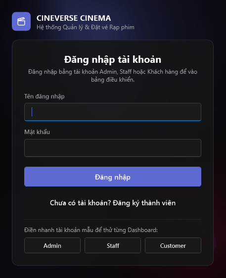
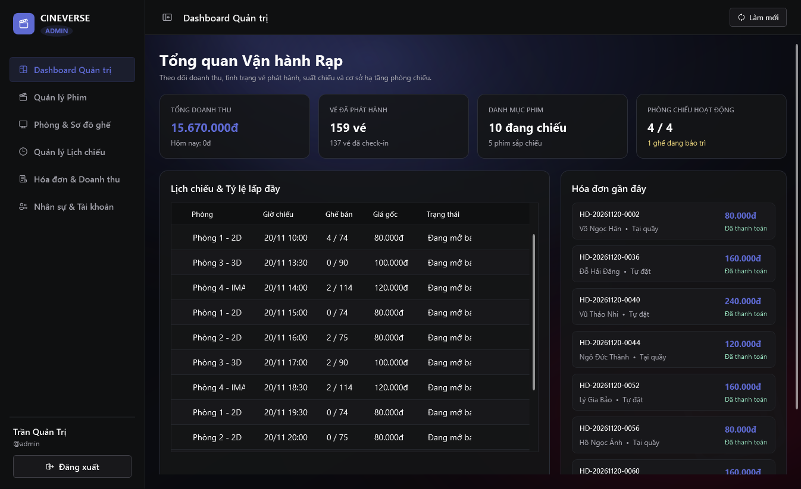
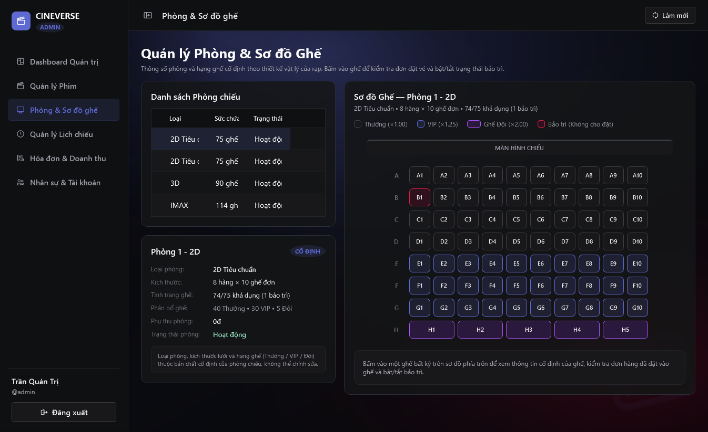
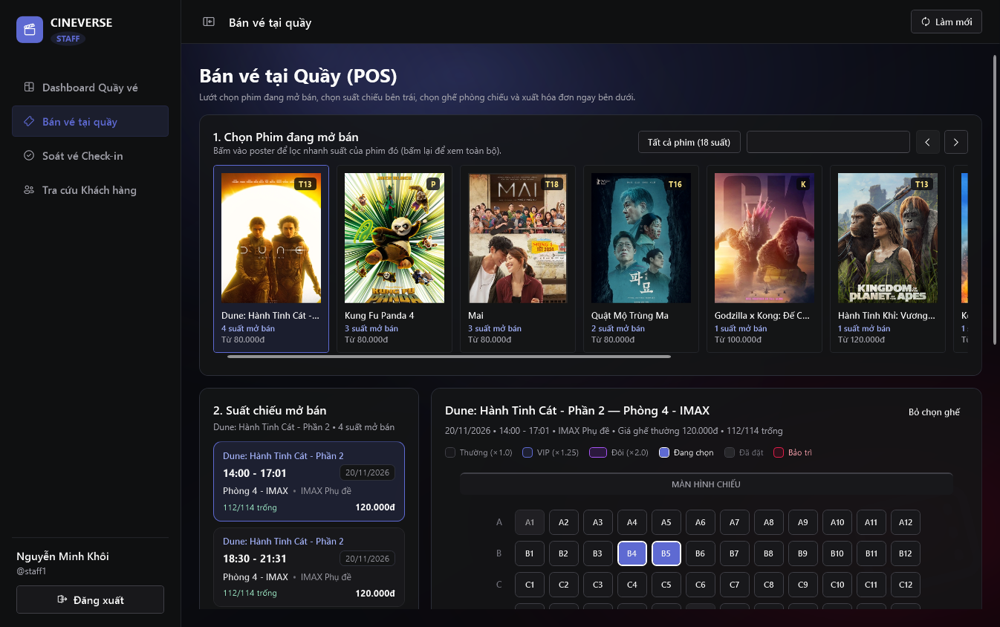
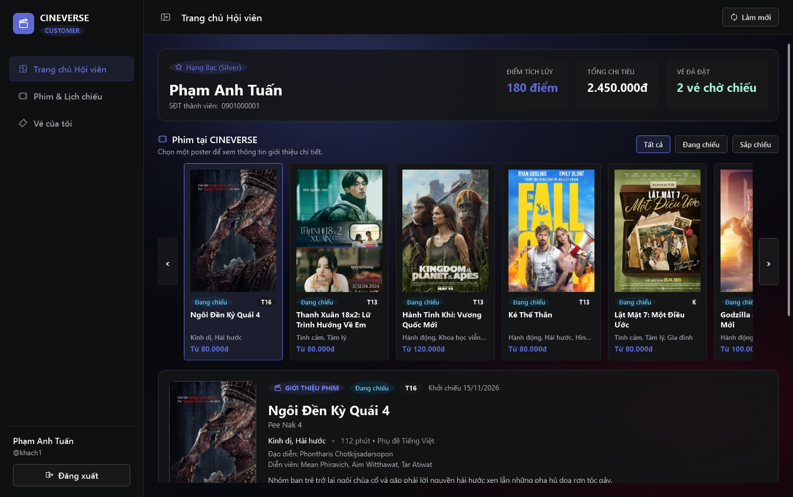
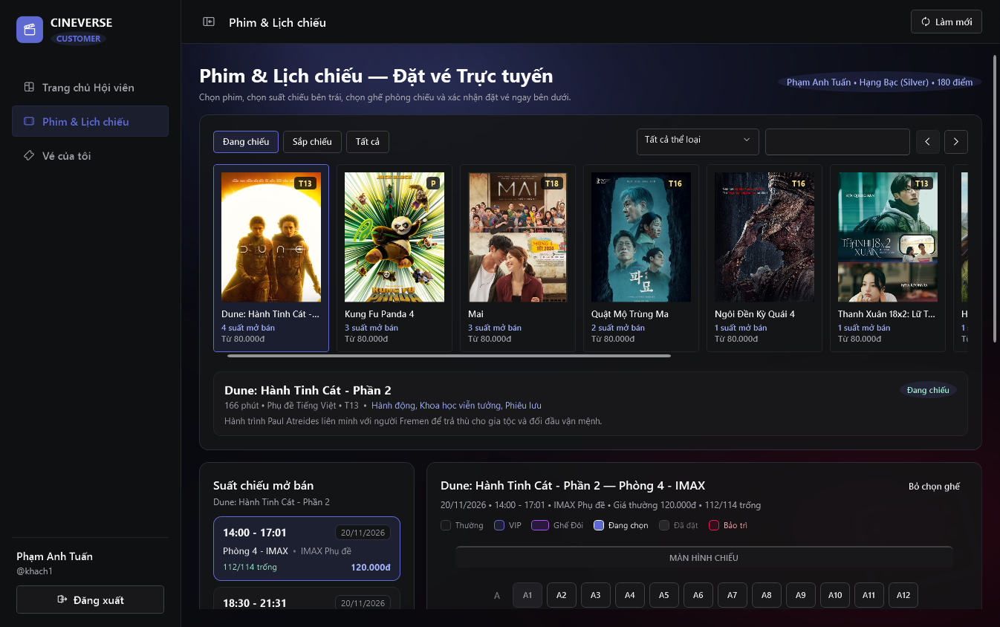

# CINEVERSE CINEMA (`CinemaManageProject`)

Ứng dụng desktop quản lý rạp chiếu phim và đặt vé xây dựng bằng **WPF (.NET 10 Windows)**, **SQLite (`Microsoft.Data.Sqlite` + `Dapper`)**, **CommunityToolkit.Mvvm** và **WPF-UI** (Dark Theme Zinc).

```text
Views (WPF XAML / WPF-UI) <── Binding / Click ──> ViewModels (CommunityToolkit.Mvvm)
                                                          │
                                                    Data (Dapper) + Helpers
                                                          │
                                                    Database (SQLite 3)
```

Hệ thống vận hành theo 3 vai trò (`Admin`, `Staff`, `Customer`) với trọn bộ **15 màn hình** (2 cửa sổ khung + 13 màn hình chức năng).
- Chi tiết từng tệp mã nguồn, giao dịch đặt ghế, khóa ngoại & phân quyền: xem [REPORT.md](REPORT.md).
- Sơ đồ kiến trúc hệ thống: [Sơ đồ Use Case](docs/diagrams/use-case.md) • [Sơ đồ ERD (10 bảng & 13 khóa ngoại)](docs/diagrams/erd.md).

---

## Ảnh Màn hình Demo

| Đăng nhập & Đăng ký | Dashboard Quản trị (Admin) |
| :---: | :---: |
|  |  |

| Phòng chiếu & Sơ đồ Ghế (Admin) | Bán vé tại Quầy POS (Staff) |
| :---: | :---: |
|  |  |

| Trang chủ Hội viên (Customer) | Phim & Lịch chiếu — Tự đặt vé (Customer) |
| :---: | :---: |
|  |  |

---

## Kiến trúc Tổng quát 6 Thư mục Chính (`CinemaManageProject/`)

### 1. `Database/` — Cơ sở dữ liệu SQLite
- **Công nghệ:** SQLite 3, bật `PRAGMA foreign_keys = ON;`, 13 ràng buộc khóa ngoại (`CASCADE` / `RESTRICT` / `SET NULL`) và `CHECK (...)` dạng chuỗi.
- **Tổng quát:** Gồm kịch bản lược đồ `CinemaManageDB.sql` (10 bảng chuẩn hóa: `Users`, `Customers`, `Genres`, `Movies`, `MovieGenres`, `Rooms`, `Seats`, `Showtimes`, `Orders`, `Tickets`), dữ liệu mẫu `SeedData.sql` và tệp chạy thực tế `cinema.db` (29 tài khoản đã băm `PBKDF2`, 25 hội viên với 95 cặp khách–phim, 15 phim, 10 thể loại, 4 phòng / 354 ghế, 28 suất chiếu, 98 hóa đơn, 160 vé).

### 2. `Models/` — Thực thể Dữ liệu & Enum
- **Công nghệ:** C# POCO (`Nullable=enable`), `System.ComponentModel.DataAnnotations` (`[Key]`, `[Required]`, `[MaxLength]`) và Navigation Properties.
- **Tổng quát:** Chứa `CinemaEnums.cs` (11 enum chuẩn hóa toàn bộ vai trò, hạng thẻ, trạng thái phim/suất/đơn/vé, loại phòng/ghế, kênh đặt và PTTT) cùng **10 lớp Entity** ánh xạ 1-1 với 10 bảng SQLite (`User`, `Customer`, `Genre`, `Movie`, `MovieGenre`, `Room`, `Seat`, `Showtime`, `Order`, `Ticket`).

### 3. `Helpers/` — Tiện ích Dùng chung
- **Công nghệ:** `Microsoft.Data.Sqlite`, `Dapper` (`SqlMapper.TypeHandler<decimal>`), `PBKDF2-HMAC-SHA256` (`System.Security.Cryptography`), `WPF BitmapImage`.
- **Tổng quát:** Tập trung 4 lớp phụ trợ tĩnh không lưu trạng thái:
  - `DatabaseHelper`: mở kết nối SQLite bật khóa ngoại và xử lý kiểu `decimal` cho Dapper.
  - `PasswordHelper`: băm mật khẩu một chiều kèm salt ngẫu nhiên 16 byte và xác thực hằng thời gian (hỗ trợ tự nâng cấp tài khoản cũ).
  - `FormatHelper`: định dạng tiền VNĐ, ngày giờ SQLite và dịch mã trạng thái/PTTT/loại phòng/ghế sang tiếng Việt.
  - `PosterHelper`: phân giải, lưu bản sao và nạp ảnh poster không khóa tệp (`OnLoad` + `Freeze`).

### 4. `Data/` — Tầng Truy cập Dữ liệu (Dapper & SQLite)
- **Công nghệ:** `Dapper 2.1.100`, `Microsoft.Data.Sqlite 10.0.15`, SQL thuần tham số hóa (`@param`), `SqliteTransaction` và `record` DTO bất biến.
- **Tổng quát:** Tách 100% câu truy vấn SQL ra khỏi ViewModel vào **10 lớp tĩnh theo nghiệp vụ** (`AuthData`, `DashboardData`, `MovieData`, `RoomData`, `ShowtimeData`, `OrderData`, `UserData`, `BookingData`, `CheckInData`, `CustomerData`). Đảm bảo các quy tắc cốt lõi trong transaction: tính giờ kết thúc `+15 phút` & chặn trùng lịch chiếu cùng phòng, khóa kiểm tra ghế bảo trì/đã đặt trước khi phát hành hóa đơn & mã vé, soát vé check-in, hủy vé hoàn điểm và đồng bộ 1-1 `Users` ↔ `Customers`.

### 5. `ViewModels/` — Tầng Logic Hiển thị (MVVM)
- **Công nghệ:** `CommunityToolkit.Mvvm 8.4.2` (`ObservableObject`, Source Generator `[ObservableProperty]` / `[NotifyPropertyChangedFor]` / `partial void OnXxxChanged`), `ObservableCollection<T>` và `WPF-UI SymbolRegular`.
- **Tổng quát:** Gồm **17 tệp ViewModel** kế thừa `ViewModelBase` (không chứa SQL trực tiếp, dùng method `public` thay cho `ICommand`):
  - **Dùng chung (`ViewModels/`):** `ViewModelBase`, `LoginViewModel`, `MainViewModel` (Sidebar phân quyền theo vai trò), `BookingSeatItems` (mô hình ô ghế dùng chung POS & Browse).
  - **`ViewModels/Admin/` (6):** Dashboard KPI, Phim & Thể loại, Phòng & Ghế, Lịch chiếu, Hóa đơn & Doanh thu, Nhân sự & Tài khoản.
  - **`ViewModels/Staff/` (4):** Dashboard Quầy, Bán vé tại quầy (POS), Soát vé Check-in, Tra cứu & Đăng ký Khách hàng.
  - **`ViewModels/Customer/` (3):** Trang chủ Hội viên (dải poster + spotlight), Phim & Lịch chiếu (tự đặt vé online), Vé của tôi & Hủy vé.

### 6. `Views/` — Tầng Giao diện Người dùng (XAML & Code-behind)
- **Công nghệ:** WPF XAML, Data Binding (`{Binding}`), `WPF-UI 4.3.0` (`<ui:SymbolIcon>` và style Dark Theme Zinc tập trung tại `Themes/Controls.xaml`), code-behind tối giản.
- **Tổng quát:** Gồm **15 màn hình** (30 tệp `.xaml` / `.xaml.cs`):
  - **Cửa sổ khung (`Views/`):** `LoginWindow` (Đăng nhập / Đăng ký + điền nhanh demo) và `MainWindow` (Sidebar đóng/mở gọn, Topbar làm mới/đăng xuất, `ContentControl` chuyển đổi 13 màn hình con và chuyển tiếp cuộn chuột mượt qua các danh sách lồng nhau).
  - **`Views/Admin/` (6), `Views/Staff/` (4), `Views/Customer/` (3):** Các `UserControl` tương ứng 1-1 với từng ViewModel; code-behind chỉ khởi tạo, chuyển tiếp sự kiện `Click`/`KeyDown`, chuyển tiếp `PasswordBox` và mở hộp thoại chọn tệp/xác nhận.

---

## Yêu cầu Môi trường, Chạy ứng dụng & Kiểm thử

> [!IMPORTANT]
> **Yêu cầu bắt buộc:**
> - **Hệ điều hành:** **Chỉ hỗ trợ Windows (Windows 10 / Windows 11)** do ứng dụng sử dụng **WPF (`net10.0-windows`)** và Win32 DWM (`dwmapi.dll`); không hỗ trợ macOS hoặc Linux.
> - **SDK:** Bắt buộc cài **.NET 10 SDK** (`net10.0-windows`).

### Build, Chạy ứng dụng & Chạy kiểm thử tự động (`xUnit`)
```powershell
dotnet build CinemaManageProject.slnx
dotnet test CinemaManageProject.slnx
dotnet run --project CinemaManageProject\CinemaManageProject.csproj
```
- Bộ kiểm thử tự động [CinemaManageProject.Tests](CinemaManageProject.Tests/) (`xUnit`) gồm **18 test** bao phủ đầy đủ các luồng **Đăng nhập / Đăng ký / Băm PBKDF2** (`AuthTests`), **Đặt vé & Chống đặt trùng ghế** (`BookingTests`) và **Hủy vé & Hoàn điều chỉnh điểm** (`CancelTicketTests`), tự cô lập và khôi phục bản sao `cinema.db` sau mỗi lần chạy.

---

## Hướng dẫn Xóa Database Demo trước khi Chạy Dữ liệu Mới

Khi chạy ứng dụng, tệp CSDL gốc `CinemaManageProject\Database\cinema.db` được sao chép sang thư mục thực thi `CinemaManageProject\bin\Debug\net10.0-windows\Database\cinema.db`.

1. **Làm mới lại dữ liệu demo ban đầu (sau khi thử đặt/hủy vé):**
   ```powershell
   # Đóng ứng dụng trước, sau đó xóa bản copy runtime và build/chạy lại
   Remove-Item -Force CinemaManageProject\bin\Debug\net10.0-windows\Database\cinema.db
   dotnet run --project CinemaManageProject\CinemaManageProject.csproj
   ```

2. **Xóa sạch hoàn toàn dữ liệu demo để khởi tạo CSDL trắng chạy dữ liệu mới:**
   ```powershell
   # Bước 1: Đóng ứng dụng và xóa tệp cinema.db demo (cả bản gốc lẫn bản runtime)
   Remove-Item -Force CinemaManageProject\Database\cinema.db -ErrorAction SilentlyContinue
   Remove-Item -Force CinemaManageProject\bin\Debug\net10.0-windows\Database\cinema.db -ErrorAction SilentlyContinue

   # Bước 2: Khởi tạo lại cinema.db trống chỉ có lược đồ 10 bảng từ CinemaManageDB.sql (cần sqlite3 CLI)
   Get-Content -Raw CinemaManageProject\Database\CinemaManageDB.sql | sqlite3 CinemaManageProject\Database\cinema.db
   ```
   - **Lưu ý sau khi tạo DB trống:**
     - Bạn có thể tự chèn 1 tài khoản `Admin` ban đầu (mật khẩu lưu theo định dạng `PBKDF2` từ `PasswordHelper.HashPassword(...)` hoặc chuỗi plain-text tạm để hệ thống tự nâng cấp sang `PBKDF2` ở lần đăng nhập đầu tiên) và cấu hình bảng `Rooms`/`Seats`, hoặc đăng ký tài khoản hội viên mới trực tiếp tại `LoginWindow`.
     - Nếu muốn khôi phục lại bộ dữ liệu mẫu đầy đủ bất kỳ lúc nào:
       ```powershell
       Get-Content -Raw CinemaManageProject\Database\SeedData.sql | sqlite3 CinemaManageProject\Database\cinema.db
       ```

---

## Tài khoản Demo (`Database/SeedData.sql`)

> [!NOTE]
> **Lưu ý quan trọng:** Toàn bộ tài khoản và mật khẩu demo dưới đây **chỉ dùng cho mục đích học tập, kiểm thử nội bộ và trình diễn đồ án** — tuyệt đối không sử dụng lại mật khẩu mẫu trong môi trường triển khai thực tế.

| Vai trò | Tên đăng nhập | Mật khẩu | Ghi chú |
| :--- | :--- | :--- | :--- |
| **Admin** | `admin` | `Admin@123` | Quản trị toàn rạp & xem KPI doanh thu |
| **Staff** | `staff1` | `Staff@123` | Bán vé quầy, check-in, tra cứu hội viên (`staff1..3`) |
| **Customer** | `khach1` | `Khach@123` | Hội viên Silver, 180 điểm (`khach1..25`) |
