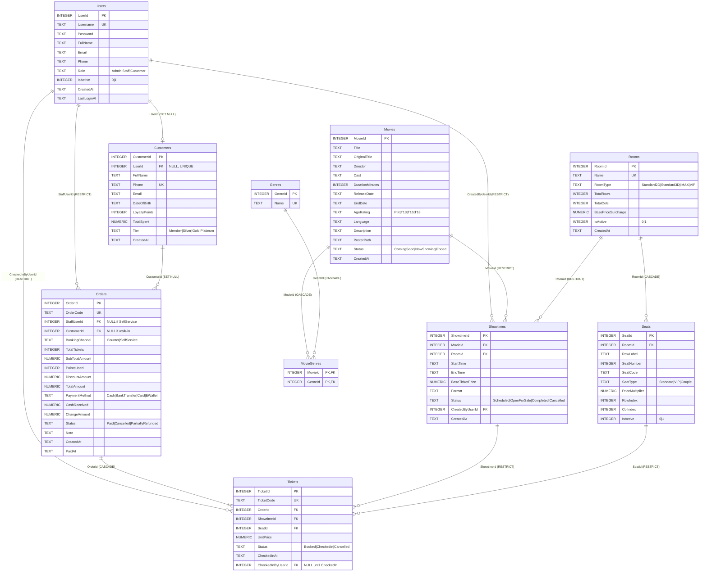

# Sơ đồ Thực thể Liên kết (ERD) — CINEVERSE CINEMA (`CinemaManageDB.sql`)

Cơ sở dữ liệu SQLite (`CinemaManageProject/Database/cinema.db`) gồm **10 bảng chuẩn hóa** và **13 ràng buộc khóa ngoại** được thực thi nghiêm ngặt qua `PRAGMA foreign_keys = ON;`.

## 1. Sơ đồ ERD (10 Bảng & 13 Khóa ngoại)

---

## 2. Tổng hợp 13 Ràng buộc Khóa ngoại & Chính sách Xóa (`ON DELETE`)

| STT | Bảng con (`FK`) | Tham chiếu (`PK`) | Chính sách `ON DELETE` | Ý nghĩa nghiệp vụ |
| :-: | :--- | :--- | :---: | :--- |
| 1 | `Customers.UserId` *(UNIQUE, NULL)* | `Users.UserId` | `SET NULL` | Cho phép hội viên tại quầy (`UserId = NULL`); nếu gỡ tài khoản app thì hồ sơ chi tiêu không bị mất dây chuyền. |
| 2 | `MovieGenres.MovieId` | `Movies.MovieId` | `CASCADE` | Xóa phim (khi chưa có suất chiếu) sẽ tự dọn liên kết thể loại. |
| 3 | `MovieGenres.GenreId` | `Genres.GenreId` | `CASCADE` | Xóa thể loại sẽ tự dọn liên kết trong bảng nối. |
| 4 | `Seats.RoomId` | `Rooms.RoomId` | `CASCADE` | Ghế là thành phần phụ thuộc hoàn toàn vào phòng chiếu. |
| 5 | `Showtimes.MovieId` | `Movies.MovieId` | `RESTRICT` | Chặn xóa phim đã phát sinh lịch chiếu để bảo toàn lịch sử. |
| 6 | `Showtimes.RoomId` | `Rooms.RoomId` | `RESTRICT` | Chặn xóa phòng đã có lịch chiếu. |
| 7 | `Showtimes.CreatedByUserId` | `Users.UserId` | `RESTRICT` | Chặn xóa tài khoản quản trị đã tạo suất chiếu. |
| 8 | `Orders.StaffUserId` *(NULL)* | `Users.UserId` | `RESTRICT` | Chặn xóa nhân viên đã lập hóa đơn quầy (chỉ cho khóa tài khoản `IsActive = 0`). |
| 9 | `Orders.CustomerId` *(NULL)* | `Customers.CustomerId` | `SET NULL` | Cho phép khách vãng lai (`CustomerId = NULL`) và giữ nguyên hóa đơn kế toán. |
| 10 | `Tickets.OrderId` | `Orders.OrderId` | `CASCADE` | Vé thuộc về một hóa đơn duy nhất; xóa hóa đơn nháp/test sẽ dọn luôn vé con. |
| 11 | `Tickets.ShowtimeId` | `Showtimes.ShowtimeId` | `RESTRICT` | Chặn xóa suất chiếu đã phát sinh vé bán. |
| 12 | `Tickets.SeatId` | `Seats.SeatId` | `RESTRICT` | Chặn xóa ghế đã có lịch sử vé đặt. |
| 13 | `Tickets.CheckedInByUserId` *(NULL)* | `Users.UserId` | `RESTRICT` | Chặn xóa nhân viên đã thực hiện soát vé check-in. |
