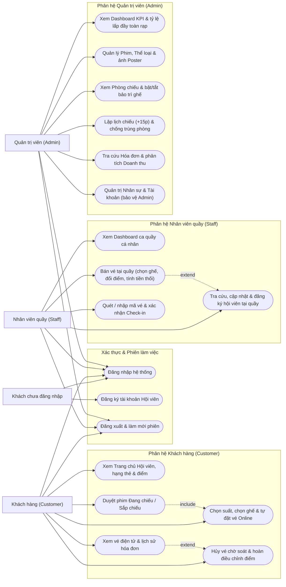

# Sơ đồ Use Case — CINEVERSE CINEMA (`CinemaManageProject`)

Tài liệu mô tả toàn bộ các ca sử dụng (Use Cases) và phạm vi phân quyền của **3 tác nhân (Actors)** trong hệ thống quản lý rạp chiếu phim **CINEVERSE CINEMA**.

## 1. Sơ đồ Use Case Tổng quan

---

## 2. Bảng Ánh xạ Tác nhân — Chức năng — Màn hình

| Tác nhân | Nhóm chức năng chính | Màn hình tương ứng (`CinemaManageProject/Views/`) | Quy tắc nghiệp vụ trọng tâm |
| :--- | :--- | :--- | :--- |
| **Chưa đăng nhập** | Đăng nhập, đăng ký hội viên mới | `LoginWindow` | Xác thực `PBKDF2-HMAC-SHA256`, đăng ký tự gán vai trò `Customer` và tạo đồng bộ hồ sơ `Customers`. |
| **Customer** | Trang chủ hội viên, tự đặt vé online, xem & hủy vé | `Customer/CustomerDashboardView`, `CustomerBrowseView`, `CustomerMyTicketsView` | Chỉ đặt kênh `SelfService` (Chuyển khoản / Ví điện tử / Thẻ); chỉ hủy được vé `Booked` thuộc chính tài khoản của mình. |
| **Staff** | Dashboard quầy, bán vé POS, soát vé check-in, quản lý hội viên quầy | `Staff/StaffDashboardView`, `StaffPosView`, `StaffCheckInView`, `StaffCustomersView` | Bán vé kênh `Counter` (đủ 4 PTTT gồm tiền mặt & tiền thối); soát vé ghi `CheckedInAt`, `CheckedInByUserId`; đăng ký hội viên quầy (`UserId = NULL`). |
| **Admin** | Dashboard toàn rạp, phim, phòng/ghế, lịch chiếu, hóa đơn/doanh thu, tài khoản | `Admin/AdminDashboardView`, `AdminMoviesView`, `AdminRoomsView`, `AdminShowtimesView`, `AdminOrdersView`, `AdminUsersView` | Không thể bảo trì ghế đang có vé hiệu lực; khóa sửa thông số cốt lõi suất đã có vé; bảo vệ nghiêm ngặt tài khoản `Admin` gốc. |
